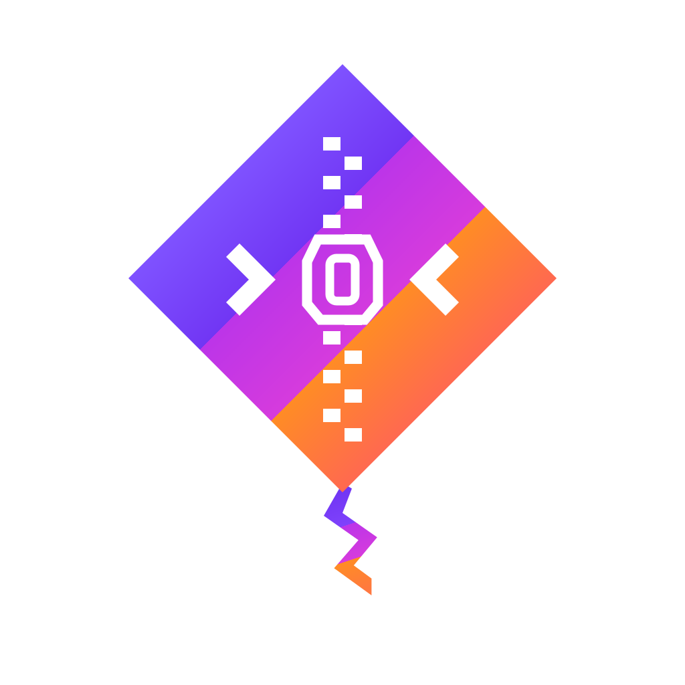

# ArchiveKodec — Compression seam

Original logo concept created on 2026-09-05.

An interlocking zipper runs through the kite as its spine; inward chevrons express compression and a slider opens the archive.

The shared short-tailed diamond and violet/magenta/orange palette connect it to the Kite family and Kotlin. Its internal geometry expresses this library's purpose, as documented in its repository README.

- [Editable SVG](archivekodec-concept.svg)
- [1024 × 1024 transparent PNG](archivekodec-concept.png)

Constructed directly as SVG paths, shapes, masks and gradients, extending the established KiteConfig diamond-and-tail geometry. No embedded raster image, external font, or external asset dependency. PNG rendered with librsvg. This is an artwork exploration; it has not replaced any application or documentation assets.
